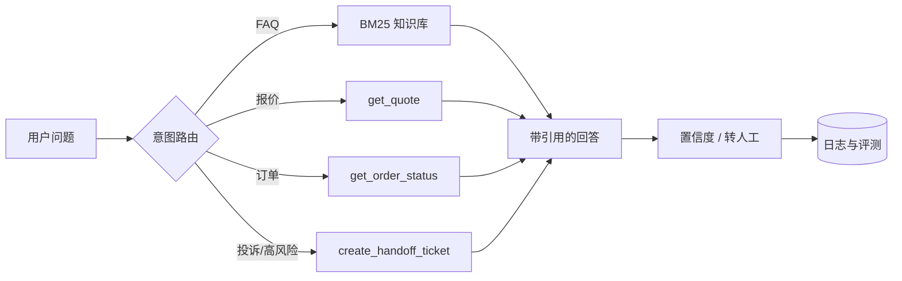

# AI 产品 / Agent / 工作流自动化 · 可复现作品集

一个面向 **AI 产品实习生（AI Agent / 自动化方向）** 岗位的作品集仓库。它把简历里的三段项目描述，拆成可运行的代码、合成数据、评测集、PRD 和复盘报告。

> **重要说明**：本仓库是简历项目的 **可复现 Demo**，使用合成数据，不代表任何真实公司数据、真实实习产出或真实上线效果。仓库中的公司、价格、政策、指标均为虚构，仅用于验证产品设计与工程实现。面试时请讲清楚“这是我自己搭的 Demo”，不要把 Demo 包装成某公司的真实项目。

<p>
  
  
  
  
</p>

## 这个仓库复现了什么

| 简历里的项目 | 仓库中的实现 | 可验证的证据 |
| --- | --- | --- |
| 企业知识库客服 Agent（Dify + RAG + Function Calling） | 210 条 FAQ 知识库、BM25 检索、意图路由、4 个工具、引用与置信度、转人工工单、60 条评测集 | [`reports/eval_report.md`](reports/eval_report.md) |
| 内容生产与数据分析 Workflow（Coze + n8n + GPT/Claude） | 内容 Brief → 标题/脚本/配图提示词 → 合规检查 → 审核状态；90 条 30 天运营数据与指标问答 | [`reports/content_brief.md`](reports/content_brief.md)、[`reports/content_report.md`](reports/content_report.md) |
| 环保投标资料摘要与流程提效 | 3 份合成招标文件的结构化抽取、跨文件检索；19 个流程节点的机会矩阵 | [`reports/bid_summary.md`](reports/bid_summary.md)、[`reports/process_opportunities.md`](reports/process_opportunities.md) |

另外补齐了产品经理工作产物：3 份 PRD、合成用户访谈、竞品分析、流程图、评测方案、路线图和面试讲述指南。

## 关键结果（合成评测）

| 指标 | 结果 | 说明 |
| --- | ---: | --- |
| 知识库文档 | 210 | 30 个知识点 × 7 种问法 |
| FAQ 评测用例 | 50 | 40 条同义改写 + 10 条困难口语化问法 |
| Retrieval Hit@1 | 92.0% | 按 `group_id` 去重 |
| Retrieval Hit@3 | 92.0% | 困难子集 60.0%，简单子集 100.0% |
| 意图识别准确率 | 100.0% | 60 条混合用例 |
| 工具选择准确率 | 100.0% | 报价、订单、转人工、知识库检索 |
| 引用命中率 | 93.3% | 回答引用的知识点是否命中期望 |
| 内容数据 | 90 条 / 30 天 | 3 个渠道，合成数据 |
| 流程节点 | 19 个 / 4 条流程 | Top 6 自动化机会排序 |
| 单元测试 | 23 个 | `unittest`，无外部依赖 |

这些数字只说明 **当前合成评测集上的工程实现**，不是生产准确率。困难子集的失败案例保留在报告里，用于说明下一步优化方向。

## 快速开始

要求：Python 3.10+，不需要安装任何第三方包，不需要 API Key。

```bash
# 1. 一键跑完所有 Demo，生成 reports/ 证据包
python -m ai_portfolio.cli demo

# 2. 启动本地 Web Demo
python -m ai_portfolio.web
# 打开 http://127.0.0.1:8000
```

Windows PowerShell 也可以直接执行：

```powershell
python -m ai_portfolio.cli demo
python -m ai_portfolio.web
```

### 单独运行

```bash
# 客服 Agent：报价
python -m ai_portfolio.cli agent --question "租赁 2 台移动式污水处理设备 10 天，大概多少钱？"

# 客服 Agent：订单
python -m ai_portfolio.cli agent --question "订单 EQ2026003 现在什么进度？"

# 客服 Agent：投诉转人工
python -m ai_portfolio.cli agent --question "设备故障三天没人处理，我要投诉，转人工"

# 检索与 Agent 评测
python -m ai_portfolio.cli eval

# 内容工作流
python -m ai_portfolio.cli content --topic "污水设备租赁的 5 个成本坑" --channel 公众号

# 内容数据报告 / 数据问答
python -m ai_portfolio.cli content-report
python -m ai_portfolio.cli analytics-ask --question "哪个渠道线索最多？"

# 招标文件摘要与跨文件检索
python -m ai_portfolio.cli bid --file data/environment/bid_docs/2026_园区污水处理设备租赁项目_招标文件.md
python -m ai_portfolio.cli bid-ask --question "园区污水处理项目的投标截止时间和预算是什么？"

# 流程自动化机会矩阵
python -m ai_portfolio.cli process
```

## 架构



- **客服 Agent**：规则意图路由 + BM25 检索 + 工具调用 + 引用 + 置信度阈值 + 人工接管。
- **内容 Workflow**：模板化生成（可替换为 LLM）+ 合规规则 + 人工审核状态 + 运营数据聚合。
- **投标助手**：Markdown 结构化抽取 + BM25 跨文件检索 + 关键日期/预算/资质/评分/风险条款。
- **Web Demo**：Python `http.server`，零前端依赖，四个 Tab 直接演示。

更完整的设计说明见 [`docs/ARCHITECTURE.md`](docs/ARCHITECTURE.md)。

## 目录结构

```text
ai-intern-portfolio/
├─ ai_portfolio/
│  ├─ rag/                 # 客服 RAG Agent、BM25、工具、评测
│  ├─ content/             # 内容 Workflow、合规检查、数据分析
│  ├─ environment/         # 招标摘要、流程机会分析
│  ├─ cli.py               # 命令行入口
│  ├─ demo.py              # 一键生成证据包
│  └─ web.py               # 本地 Web Demo
├─ data/
│  ├─ customer_service/    # FAQ、评测集、订单、价格、工具 schema
│  ├─ content/             # 内容日历、30 天运营数据
│  └─ environment/         # 招标文件、流程节点
├─ docs/                   # PRD、架构、数据卡、访谈、竞品、面试指南
├─ prompts/                # 客服/内容/投标/评测 Prompt
├─ integrations/           # n8n、Coze 对接说明与工作流
├─ reports/                # 自动生成的评测与复盘证据
├─ scripts/generate_data.py
├─ tests/                  # 23 个 unittest
└─ .github/workflows/ci.yml
```

## 和 JD 的对应关系

| JD 要求 | 本仓库证据 |
| --- | --- |
| AI 产品设计、业务流程梳理 | 3 份 PRD、4 条流程的 Mermaid 图、19 个节点的机会矩阵 |
| Prompt Engineering / RAG / Agent / Workflow | `ai_portfolio/rag/`、`prompts/`、`integrations/n8n/` |
| ChatGPT / Claude / Gemini / Midjourney / Runway | 内容工作流的模型适配层与配图/视频提示词；工具选型对比 |
| 客服、内容、营销、数据分析、自动化办公 | 客服 Agent、内容 Workflow、运营数据问答、投标摘要 |
| 与 AI 工程师协作 | 工具 schema、评测口径、CI、可复现实验报告 |
| 学习能力与作品集 | 从 0 到 1 的代码、数据、PRD、复盘、失败分析 |

完整的逐条映射见 [`docs/JD_MAPPING.md`](docs/JD_MAPPING.md)。

## 设计取舍

1. **默认不接大模型**：为了可复现和零成本，FAQ 回答使用“检索 + 模板化 grounded composer”；报价/订单/工单是确定性工具。这样 CI 不会因为 API 波动而失败。
2. **合成数据但保留真实复杂度**：FAQ 有 30 个知识点 × 7 种问法，包含同义改写和 10 条口语化困难问法；不是只有几条“玩具数据”。
3. **评测先行**：先定义 60 条用例和指标，再调检索与路由；报告保留失败案例，不把 100% 当成默认目标。
4. **产品文档和代码同仓**：PRD、访谈、流程图、Prompt 和代码放在一起，方便面试时从“为什么做”讲到“怎么做”。
5. **安全边界**：投诉、退款、合同纠纷等高风险场景默认转人工，不让 Agent 直接承诺。

## 已知限制

- 困难口语化问法的 Hit@3 只有 60%，主要失败在“开票/发票”“被偷/丢失”“晚还/逾期”等同义词鸿沟。
- 默认回答是模板化的，不是自然语言大模型生成；接入 LLM 后需要重新做事实性和语气评测。
- 运营数据是合成的，不能用于真实业务决策。
- 招标摘要基于规则和关键词，复杂表格、扫描件和 PDF 需要 OCR/版面解析。
- Web Demo 是单机演示，没有鉴权、限流、持久化和多租户。

下一步见 [`docs/ROADMAP.md`](docs/ROADMAP.md)。

## 文档索引

- [JD 映射](docs/JD_MAPPING.md)
- [架构设计](docs/ARCHITECTURE.md)
- [数据卡](docs/DATA_CARD.md)
- [评测方法与失败分析](docs/EVALUATION.md)
- [客服 Agent PRD](docs/PRD_AI_CUSTOMER_SERVICE.md)
- [内容 Workflow PRD](docs/PRD_CONTENT_WORKFLOW.md)
- [投标助手 PRD](docs/PRD_BID_ASSISTANT.md)
- [合成用户访谈](docs/INTERVIEW_NOTES.md)
- [流程图与机会矩阵](docs/PROCESS_MAPS.md)
- [竞品与工具选型](docs/COMPETITOR_ANALYSIS.md)
- [面试讲述指南](docs/PORTFOLIO_GUIDE.md)
- [发布到 GitHub](docs/PUBLISHING.md)

## License

MIT。合成数据可自由用于学习与 Demo，但请保留“合成数据 / 非真实企业数据”的说明。

