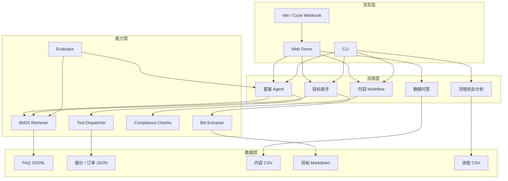
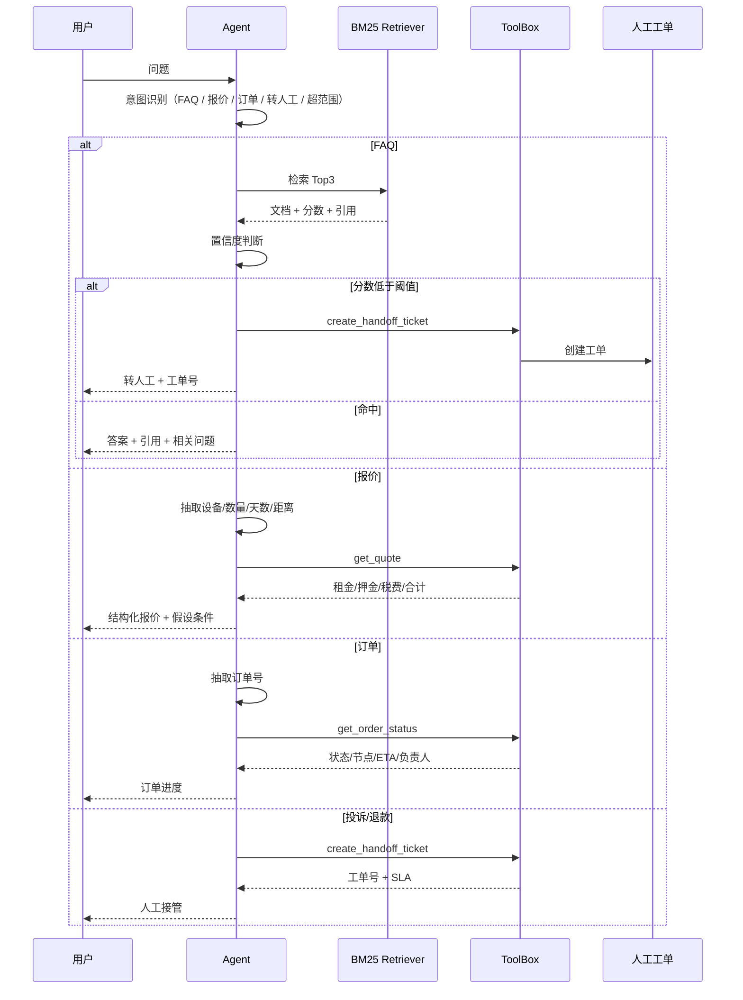
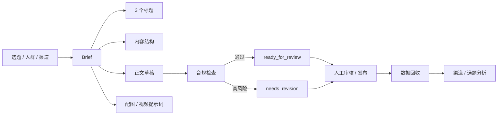
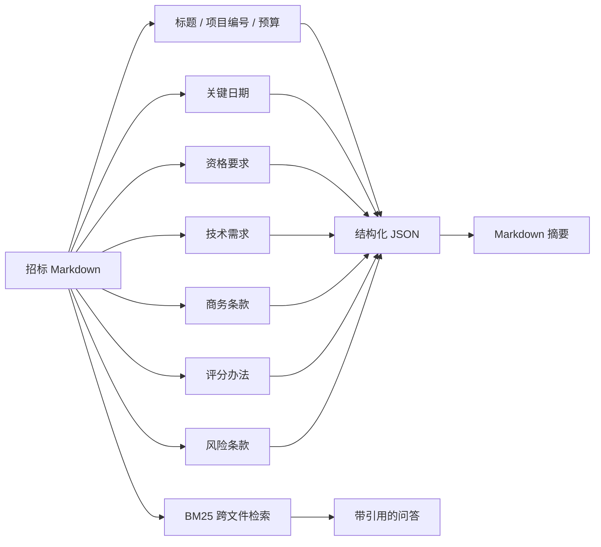

# 架构设计

## 1. 设计目标

这个仓库不是为了做“万能 AI 助手”，而是为了回答三个产品问题：

1. **哪些场景值得用 AI？** 高频、重复、有明确输入输出、可衡量的场景优先；高风险场景先做辅助，不直接自动化。
2. **用哪种 AI 形态？** 知识问答用 RAG；结构化计算用工具；多步骤内容生产用 Workflow；投诉/退款用人工接管。
3. **怎么判断做得好？** 每个场景都有基线、评测集、失败案例和人工兜底，而不是只看 Demo 是否“看起来聪明”。

## 2. 总体架构



## 3. 客服 Agent 链路



### 关键设计

| 设计 | 原因 |
| --- | --- |
| 规则意图路由 | 场景边界清晰、可解释、方便评测；后续可替换为小模型分类器 |
| BM25 + 字符 unigram/bigram | 中文短文本、零依赖、可复现；比纯关键词更稳 |
| 按 `group_id` 去重 | 同一知识点的 7 种问法不应占据 Top3，避免“假多样性” |
| 引用返回 | 让用户和评测都能追溯答案来自哪条知识 |
| 置信度阈值 | 低分不硬答，直接转人工，降低错误承诺风险 |
| 工具而非 LLM 计算 | 报价、订单必须可审计，不能用模型“算” |
| 高风险词直接转人工 | 投诉、退款、纠纷、律师、曝光等场景不让 Agent 承诺 |

## 4. 内容 Workflow



- 默认 Writer 是模板化的，保证离线可复现。
- `prompts/content_writer.md` 提供了可直接替换为 GPT/Claude 的 Prompt。
- 合规检查覆盖绝对化用语、数字承诺、长度、感叹号、emoji 数量。
- 数据回收使用 90 条合成运营数据，输出渠道 CPL、线索转化、周环比、Top 选题。

## 5. 投标助手



当前实现针对 Markdown 结构化文本；真实招标文件常见 PDF、扫描件、表格和附件，需要增加 OCR、版面分析和表格解析。

## 6. 流程机会矩阵

评分公式：

```text
月工时 = 平均耗时（分钟） × 月发生量 / 60
优先级分 = 月工时 × 自动化潜力 × 数据就绪度 / 风险等级
预计节省工时 = 月工时 × 自动化潜力 × 60%（保守实现率）
```

为什么除以风险：投诉、合同用印等高风险节点即使工时高，也不应该直接自动化。先做“AI 辅助 + 人工复核”，再逐步提高自动化比例。

## 7. 代码模块

| 模块 | 职责 |
| --- | --- |
| `ai_portfolio/rag/bm25.py` | 零依赖 BM25 |
| `ai_portfolio/rag/retriever.py` | 知识库加载、检索、引用 |
| `ai_portfolio/rag/tools.py` | 报价、订单、工单、知识库工具 |
| `ai_portfolio/rag/agent.py` | 意图路由、槽位抽取、回答组装 |
| `ai_portfolio/rag/eval.py` | Hit@k、MRR、意图/工具/引用评测 |
| `ai_portfolio/content/pipeline.py` | 内容 Brief 与脚本 |
| `ai_portfolio/content/checks.py` | 合规与质量检查 |
| `ai_portfolio/content/analytics.py` | 运营指标聚合与数据问答 |
| `ai_portfolio/environment/bid.py` | 招标摘要与检索 |
| `ai_portfolio/environment/process.py` | 流程机会排序 |
| `ai_portfolio/web.py` | 零依赖 Web Demo |
| `ai_portfolio/cli.py` | 命令行入口 |

## 8. 失败模式与兜底

| 失败模式 | 当前处理 | 下一步 |
| --- | --- | --- |
| 知识库未命中 / 低分 | 转人工，带工单号 | 增加 query expansion、同义词词典、用户日志回流 |
| 报价参数缺失 | 追问设备/数量/租期 | 多轮槽位填充与默认值提示 |
| 订单号不存在 | 提示核对订单号，给出相似订单 | 增加模糊匹配与权限校验 |
| 用户情绪激烈 | 投诉/退款词直接转人工 | 增加情绪分类与优先级 |
| 内容绝对化用语 | 合规检查拦截，状态改为待修改 | 接入品牌词库与人工二审 |
| 招标文件格式复杂 | 当前只支持 Markdown | PDF/OCR/表格解析 |
| LLM 幻觉 | 默认模板化回答；工具结果不作为生成内容 | 接入 LLM 时加 grounded prompt + 引用校验 |

## 9. 如果接入真实 LLM

建议分三步：

1. **离线评测**：用同一套 60 条用例，对比模板 Writer 与 LLM Writer 的事实性、引用率、语气、成本。
2. **小流量灰度**：只开放 FAQ 和内容初稿，不开放报价/订单承诺；记录转人工率和用户反馈。
3. **上线门槛**：引用命中率、事实错误率、P95 延迟、单次成本达到阈值后才扩大流量。

具体 Prompt 见 [`prompts/`](../prompts/)。
