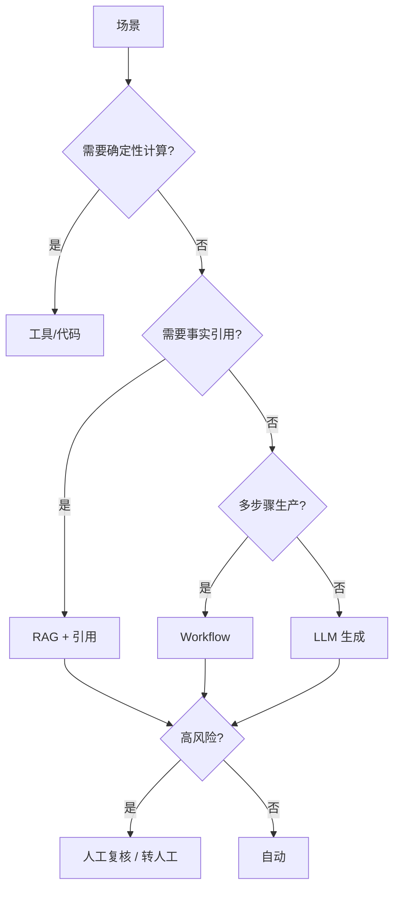

# 竞品与工具选型

> 本文是产品练习，不是采购建议。工具功能和价格会变化，落地前需要重新验证。

## 1. 选型原则

1. **先看场景，不先看工具**：FAQ、报价、内容、投标的形态不同。
2. **能确定性计算就不要用模型**：报价、订单、税率、日期。
3. **能引用就不要自由发挥**：客服、投标、政策。
4. **高风险必须人工接管**：投诉、退款、合同、验收承诺。
5. **先用最轻的方案验证**：一个 Python 脚本 + 20 条评测，比先买平台更有价值。

## 2. 平台对比

| 工具 | 擅长 | 不擅长 | 适合阶段 | 本仓库对应 |
| --- | --- | --- | --- | --- |
| Dify | RAG 应用、Agent、工作流编排、可视化 | 复杂权限、深度定制、私有化运维 | 快速验证 / 内部工具 | 客服 Agent 的产品形态参考 |
| Coze | Bot/插件/工作流、上手快、生态多 | 复杂业务逻辑、企业级治理 | 快速原型 / 轻应用 | 内容 Workflow、客服 Bot |
| Flowise | 开源可视化 LLM 编排、可自部署 | 需要工程维护、复杂前端 | 私有化 / 定制 | RAG 链路参考 |
| n8n | 系统集成、定时任务、Webhook、低代码 | 复杂 AI 逻辑、评测 | 自动化“胶水层” | 内容定时生成、飞书/企微推送 |
| 自研 Python | 完全可控、可测试、可评测 | 前端/权限/运维要自己做 | 核心链路 / 作品集 | 本仓库主体 |

## 3. 模型对比（产品视角）

| 模型 | 适合 | 注意 |
| --- | --- | --- |
| GPT 系列 | 通用推理、结构化输出、工具调用 | 成本、数据合规、版本变化 |
| Claude | 长文阅读、写作、条款分析 | 工具生态、成本 |
| Gemini | 多模态、长上下文、Google 生态 | 区域可用性、合规 |
| Midjourney | 配图、风格化视觉 | 文字准确性、品牌一致性 |
| Runway | 视频生成、动态素材 | 时长、成本、版权 |

**本仓库的选择**：默认不接模型，用模板化 Writer + 工具 + BM25，保证可复现；接入时按场景分工，不追求“一个模型包打天下”。

## 4. 为什么客服不用纯 LLM

- 价格、押金、SLA 必须可审计。
- 知识库更新后要能立即生效。
- 低置信度要能转人工。
- 评测要能定位是“检索错”还是“生成错”。

因此采用 **RAG + 工具 + 模板化 grounded composer**。LLM 可以用在“改写语气”和“多轮澄清”，但不做事实来源。

## 5. 为什么内容用 Workflow 而不是一个长 Prompt

- 选题、标题、脚本、配图、合规、审核是不同步骤，应该分开评估。
- 合规检查必须是确定性规则，不能靠模型“自觉”。
- 发布和审核需要人工节点。
- 出问题时能定位是哪一步。

## 6. 为什么投标先用规则抽取

- 招标文件的日期、金额、资质、评分是强结构信息。
- 规则抽取保留原文，方便复核。
- LLM 摘要容易“改写”掉关键条件。
- 后续可以加 LLM 做归类和改写，但必须保留引用。

## 7. 选型决策树

## 8. 如果要在公司落地

建议顺序：

1. 用 n8n/Coze 做 1—2 个低风险流程的 PoC（日报、内容初稿）。
2. 用 Dify/自研做客服 RAG，先只读知识库，不接报价。
3. 建评测集和知识库运营机制。
4. 再接工具（报价、订单），加人工确认。
5. 最后考虑多 Agent、自动执行、权限和审计。

不要一开始就做“全自动企业大脑”。
