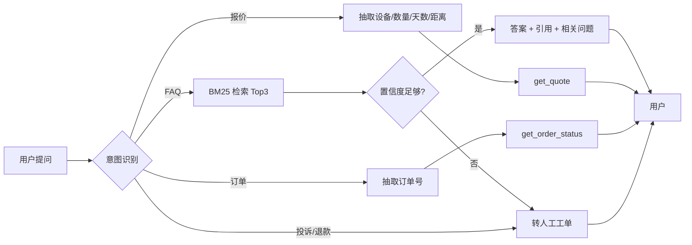

# PRD：企业知识库客服 Agent

| 字段 | 内容 |
| --- | --- |
| 产品 | 环保设备租赁客服 Agent |
| 版本 | v0.1（作品集 Demo） |
| 作者 | 作品集项目 |
| 状态 | 可运行原型 |
| 数据 | 合成 FAQ / 订单 / 价格 |

> 本文是作品集 PRD，不是某公司真实需求文档。所有业务数据均为合成数据。

## 1. 背景与问题

环保设备租赁的客服咨询有三个特点：

1. **重复问题多**：押金、运费、安装、维保、发票、退租等占大多数。
2. **答案有强约束**：报价、押金、SLA、违约金不能由模型随意生成。
3. **高风险场景多**：投诉、退款、合同纠纷一旦答错，会带来真实损失。

当前 Demo 要验证：能否用“RAG + 工具 + 转人工”把常见问题自动化，同时把高风险场景安全地交给人。

## 2. 目标与非目标

### 目标

- 让常见 FAQ 的首响从“等人回”变成“即时回答 + 引用”。
- 让报价、订单查询走确定性工具，不让模型计算。
- 低置信度、投诉、退款、纠纷自动转人工，并生成工单。
- 建立可复现的评测集，持续衡量检索、意图、工具和引用质量。

### 非目标

- 不做真实支付、合同签署、退款操作。
- 不做多租户、权限、审计等生产级能力。
- 不做语音客服。
- 不承诺解决复杂技术故障，只做信息查询和分诊。

## 3. 用户与场景

| 用户 | 场景 | 期望 |
| --- | --- | --- |
| 环保工程公司采购 | 问租赁流程、押金、运费、发票 | 快速拿到准确答案和下一步动作 |
| 制造企业 EHS | 问选型、处理量、电源、场地 | 得到条件性建议，而不是拍脑袋结论 |
| 工地项目经理 | 问订单进度、到货时间、故障报修 | 查到订单节点，紧急时转人工 |
| 客服/运营 | 处理重复咨询、投诉 | 减少重复劳动，高风险工单不遗漏 |

## 4. 核心流程

## 5. 功能需求

| 编号 | 功能 | 优先级 | 验收标准 |
| --- | --- | --- | --- |
| F1 | FAQ 检索与回答 | P0 | Top3 检索；回答带至少 1 条引用；低分转人工 |
| F2 | 报价计算 | P0 | 输入设备/数量/天数/距离，输出租金、优惠、安装、运输、税费、押金、合计 |
| F3 | 订单查询 | P0 | 输入 9 位订单号，输出状态、节点、ETA、负责人、备注 |
| F4 | 投诉/退款转人工 | P0 | 识别高风险词，创建工单，返回工单号和 SLA |
| F5 | 超范围问题兜底 | P1 | 无领域词或低置信度时转人工，不硬答 |
| F6 | 引用与可解释 | P1 | 返回 doc id、group_id、问题、分数 |
| F7 | 多轮澄清 | P2 | 报价缺参数时追问；当前为单轮 |
| F8 | 用户反馈 | P2 | 点赞/点踩/转人工原因；当前未实现 |

## 6. 工具设计

| 工具 | 输入 | 输出 | 失败处理 |
| --- | --- | --- | --- |
| `search_knowledge_base` | query, top_k | hits（id/group/question/answer/score） | 无结果→转人工 |
| `get_quote` | equipment_type, quantity, days, distance_km | line_items + quote_id + assumptions | 参数非法→返回错误并追问 |
| `get_order_status` | order_id | status/current_step/eta/owner/note | 未找到→提示核对，给相似订单 |
| `create_handoff_ticket` | reason, summary, priority | ticket_id/status/sla | 工具异常→降级为“请致电客服” |

工具 Schema 见 [`data/customer_service/tool_schemas.json`](../data/customer_service/tool_schemas.json)。

## 7. 关键产品决策

### 7.1 为什么用 RAG，不让 LLM 直接答？

环保设备租赁的答案涉及价格、押金、SLA、税率、验收，必须可追溯。RAG 至少能回答“依据哪条知识”，也方便运营更新知识库。

### 7.2 为什么报价用工具？

报价是确定性计算，涉及数量、天数、折扣、税费、押金。让 LLM 算数不可审计，也容易出错。工具输出结构化明细，用户能核对。

### 7.3 为什么低置信度要转人工？

客服场景的错误成本高于“少答一个问题”。低分时转人工，比硬答一个看似合理的错误答案更安全。

### 7.4 为什么投诉词直接转人工？

投诉、退款、纠纷、律师、曝光等场景涉及情绪和法律责任，不适合让 Agent 自主承诺。工单至少保证“有人接”。

## 8. 评测与指标

| 层级 | 指标 | 当前值 |
| --- | --- | ---: |
| 检索 | Hit@1 / Hit@3 | 92.0% / 92.0% |
| 检索 | 困难子集 Hit@3 | 60.0% |
| 路由 | 意图准确率 | 100.0% |
| 工具 | 工具选择准确率 | 100.0% |
| 回答 | 引用命中率 | 93.3% |
| 安全 | 转人工准确率 | 100.0% |
| 性能 | 平均响应时间 | 2—3 ms（本机，无 LLM） |

生产环境还需要：一次解决率、转人工率、用户满意度、P95 延迟、单次成本、错误承诺率。

## 9. 风险与对策

| 风险 | 影响 | 对策 |
| --- | --- | --- |
| 知识库过期 | 错误答案 | 知识库版本号、有效期、变更审核 |
| 同义词鸿沟 | 检索不到 | query expansion、embedding、用户日志回流 |
| 报价参数错误 | 金额错误 | 参数校验、报价单二次确认、人工复核 |
| 用户情绪升级 | 投诉 | 情绪识别、P1 工单、主管介入 |
| 模型幻觉 | 错误承诺 | 默认模板化回答；LLM 只做改写，不做事实来源 |
| 数据泄露 | 合规风险 | 脱敏、权限、审计、最小化收集 |

## 10. 上线计划

1. **离线评测**：60 条用例 + 真实客服日志回流 200 条。
2. **灰度**：只开放 FAQ 和订单查询，报价只展示“估算”并引导人工确认。
3. **指标门槛**：引用命中 ≥ 90%，转人工准确率 ≥ 95%，P95 延迟 ≤ 3s，错误承诺率 < 0.5%。
4. **扩展**：多轮、工单系统、知识库运营后台、坐席辅助。

## 11. 开放问题

- 报价是否需要按区域/客户等级做差异化？
- 订单查询是否需要手机号/验证码校验？
- 转人工工单进入哪个系统（企微/钉钉/CRM）？
- 知识库由谁维护、多久 review 一次？
- 是否允许 Agent 主动发起退款/补偿？
