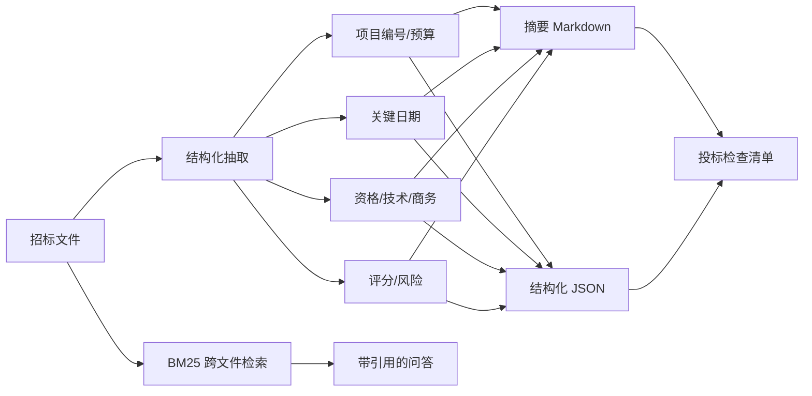

# PRD：环保投标资料摘要与流程提效助手

| 字段 | 内容 |
| --- | --- |
| 产品 | 环保项目投标资料助手 + 流程机会矩阵 |
| 版本 | v0.1（作品集 Demo） |
| 状态 | 可运行原型 |
| 数据 | 3 份合成招标文件 / 19 个合成流程节点 |

> 本文是作品集 PRD，不是某公司真实需求文档。所有项目、金额、资质、日期均为虚构。

## 1. 背景与问题

环保设备租赁/运维项目的投标和交付，存在大量“读文件、抄条款、填表格、追节点”的工作：

1. 招标文件长，关键日期、预算、资质、评分、废标条款分散。
2. 业务、技术、商务、法务各自读一遍，信息不同步。
3. 投标资格和风险条款漏看，可能导致废标。
4. 运营、客服、新媒体、数据流程靠人工，重复工时高，但不知道先改哪里。

本 Demo 要验证两件事：

- 能否把招标文件快速变成结构化的“投标检查清单”。
- 能否用统一口径给流程节点排优先级，找到 AI 自动化的切入点。

## 2. 目标与非目标

### 目标

- 从招标文件中抽取：项目编号、预算、关键日期、资格要求、技术需求、商务条款、评分办法、风险条款。
- 支持跨文件检索，回答“哪个项目投标截止更早”“预算多少”等问题。
- 用“月工时 × 自动化潜力 × 数据就绪度 / 风险”给流程节点排序。
- 输出可复用的 Markdown 摘要和 JSON，方便进入投标检查清单。

### 非目标

- 不做自动投标、自动报价、自动签章。
- 不承诺投标结果或中标率。
- 不替代法务/商务的最终审核。
- 当前不解析 PDF/扫描件/复杂表格。

## 3. 用户与场景

| 用户 | 场景 | 期望 |
| --- | --- | --- |
| 投标经理 | 拿到招标文件，快速判断能不能投 | 看到资格、预算、截止时间、评分、废标风险 |
| 技术方案 | 提取技术参数和交付要求 | 看到设备、处理量、标准、SLA |
| 商务 | 提取保证金、付款、发票、合同条款 | 看到金额、比例、时间节点 |
| 运营负责人 | 判断哪个流程先做 AI | 看到工时、潜力、风险、优先级 |
| 管理层 | 看整体提效空间 | 看到流程分布和年节省工时估算 |

## 4. 流程



## 5. 功能需求

| 编号 | 功能 | 优先级 | 验收标准 |
| --- | --- | --- | --- |
| F1 | 标题/项目编号抽取 | P0 | 识别项目编号，如 `SH-2026-WS-018` |
| F2 | 预算抽取 | P0 | 识别“预算金额 186 万元” |
| F3 | 关键日期抽取 | P0 | 识别投标截止、开标、答疑、踏勘、服务开始 |
| F4 | 资格要求抽取 | P0 | 提取资质、证书、业绩、联合体限制 |
| F5 | 技术/商务/评分/风险 | P0 | 每类输出 5—8 条原文摘要 |
| F6 | 跨文件检索 | P1 | 回答截止时间、预算等问题，带文件名 |
| F7 | 流程机会矩阵 | P0 | 19 个节点排序，输出 Top 6 |
| F8 | PDF/OCR | P2 | 当前不支持，路线图列出 |
| F9 | 投标检查清单导出 | P1 | Markdown/JSON；可扩展到 Excel |

## 6. 抽取策略

当前使用“规则 + 关键词 + 句子级摘要”：

1. 按标题/换行/句号切分。
2. 用正则识别日期、金额、项目编号。
3. 用关键词识别资格、技术、商务、评分、风险句子。
4. 过滤标题、免责声明、过短句子。
5. 每类限制 5—8 条，避免摘要过长。
6. 输出原文，不做改写，降低幻觉风险。

为什么不直接让 LLM 总结：

- 招标文件对准确性要求高，原文引用比“模型转述”更安全。
- 当前 Demo 要可复现、零成本。
- 后续可以加 LLM 做“归类 + 改写”，但必须保留原文引用和人工复核。

## 7. 流程机会矩阵

字段：

| 字段 | 含义 |
| --- | --- |
| `flow` | 运营/客服/新媒体/数据 |
| `step` | 流程节点 |
| `avg_minutes` | 单次平均耗时 |
| `monthly_volume` | 月发生量 |
| `automation_potential` | 自动化潜力 0—1 |
| `risk` | 风险 1—5 |
| `data_ready` | 数据就绪度 0—1 |

公式：

```text
月工时 = avg_minutes × monthly_volume / 60
优先级分 = 月工时 × automation_potential × data_ready / risk
预计节省工时 = 月工时 × automation_potential × 60%
```

## 8. 当前结果

- 3 份招标文件，预算分别为 186 / 68 / 240 万元。
- 关键日期、资格、技术、商务、评分、风险条款均可抽取。
- 19 个流程节点，4 条流程，Top 6 机会点。
- 合成数据下，当前月工时 1,477.9 小时，可自动化 1,045.3 小时，预计年节省 7,526.4 小时（按 60% 实现率，仅用于排序，不是收益承诺）。

## 9. 风险与对策

| 风险 | 对策 |
| --- | --- |
| 漏看废标条款 | 风险条款单独高亮；人工复核清单 |
| 日期/金额抽取错误 | 保留原文和上下文；关键字段二次核对 |
| PDF/扫描件解析失败 | OCR + 版面分析；失败时提示人工 |
| 评分办法复杂（主观分/客观分） | 结构化评分表；人工确认 |
| 流程数据靠访谈，偏差大 | 多角色访谈 + 工时日志 + 复核 |
| 自动化高风险节点 | 先辅助、后自动；保留人工确认 |

## 10. 上线计划

1. **离线**：用 10 份历史招标文件回测抽取字段，人工标注准确率。
2. **辅助**：输出摘要和检查清单，投标经理人工确认。
3. **流程**：先用工时日志校准 2 周，再排优先级。
4. **集成**：飞书/企微机器人推送摘要；投标系统附件上传。
5. **扩展**：PDF/OCR、评分表解析、投标文件生成、知识库沉淀。

## 11. 开放问题

- 招标文件来源是邮件、平台下载还是网盘？
- 哪些字段必须 100% 准确？哪些可以人工复核？
- 评分办法是否固定模板？能否结构化？
- 流程工时数据从哪里来？访谈、日志还是系统？
- 自动化机会的 ROI 要不要算人力成本？
