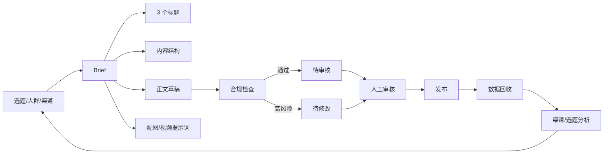

# PRD：内容生产与数据分析 Workflow

| 字段 | 内容 |
| --- | --- |
| 产品 | 环保设备租赁内容 Workflow |
| 版本 | v0.1（作品集 Demo） |
| 状态 | 可运行原型 |
| 数据 | 合成内容日历 / 30 天表现数据 |

> 本文是作品集 PRD，不是某公司真实需求文档。所有数据均为合成数据。

## 1. 背景与问题

内容运营的重复劳动集中在四段：

1. 选题靠灵感，缺少和业务目标的连接。
2. 标题、脚本、配图、审核反复沟通。
3. 多平台发布和数据回收靠手工复制。
4. 复盘停留在“这篇不错”，没有渠道/选题/CPL 的结构化结论。

本 Demo 要验证：能否把“选题 → Brief → 脚本 → 配图提示词 → 合规检查 → 审核 → 数据回收”做成一条可配置的 Workflow。

## 2. 目标与非目标

### 目标

- 把单篇内容的生产从“多人来回沟通”变成“结构化 Brief + 可审核草稿”。
- 在生成阶段就拦截绝对化用语、无法证明的数字承诺和品牌语气问题。
- 用统一口径统计渠道、选题、线索、CPL 和周环比。
- 让运营人员可以零代码调整模板和检查规则。

### 非目标

- 不做自动发布（平台 API 和账号权限复杂）。
- 不做图片/视频生成，只输出可交给 Midjourney / Runway 的提示词。
- 不做全自动投放。
- 不承诺内容效果。

## 3. 用户与场景

| 用户 | 场景 | 期望 |
| --- | --- | --- |
| 内容运营 | 每周产出 3—5 篇公众号/小红书/视频号内容 | 快速拿到标题、结构、脚本、配图提示词 |
| 市场负责人 | 审核内容合规与品牌语气 | 一眼看到风险词、数字承诺、修改建议 |
| 增长/运营 | 复盘渠道和选题 | 看到线索、CPL、转化率、周环比 |
| 销售 | 把内容变成线索 | 内容带明确 CTA 和线索入口 |

## 4. 流程

## 5. 功能需求

| 编号 | 功能 | 优先级 | 验收标准 |
| --- | --- | --- | --- |
| F1 | 生成 Brief | P0 | 输入选题/渠道/人群，输出标题、钩子、结构、脚本、CTA |
| F2 | 渠道适配 | P1 | 公众号/小红书/视频号有不同结构提示 |
| F3 | 配图/视频提示词 | P1 | 输出可直接用于 Midjourney/Runway 的英文提示词 |
| F4 | 合规检查 | P0 | 拦截绝对化用语、100%、保证、零风险等；输出评分与建议 |
| F5 | 审核状态 | P0 | 通过→`ready_for_review`；高风险→`needs_revision` |
| F6 | 内容日历 | P1 | 30 条排期，含渠道、类型、选题、状态 |
| F7 | 数据分析 | P0 | 渠道曝光/线索/转化/CPL、周环比、Top 选题 |
| F8 | 自然语言问答 | P1 | “哪个渠道线索最多”等规则化问题可答 |
| F9 | 多平台发布 | P2 | 当前不做，留出 webhook 接口 |

## 6. 生成策略

默认使用模板化 Writer，原因：

- 无 API Key 也能跑，CI 稳定。
- 内容结构可控，方便评测合规检查。
- 可以把“生成”和“检查”分开，便于替换模型。

接入 LLM 时，Prompt 见 [`prompts/content_writer.md`](../prompts/content_writer.md)。建议：

1. 用品牌语气、受众、渠道、禁用词作为系统提示。
2. 要求输出 JSON（标题数组、脚本、配图提示词、标签）。
3. 生成后必须过合规检查，不能直接发布。
4. 对数字、政策、案例做人工事实核查。

## 7. 合规规则

| 类型 | 示例 | 处理 |
| --- | --- | --- |
| 绝对化用语 | 最好、最佳、顶级、唯一 | 高风险，必须修改 |
| 无法证明的排名 | 行业第一、销量第一 | 高风险，删除或补来源 |
| 绝对化承诺 | 100%、保证、零风险、包过 | 高风险，改为条件性描述 |
| 价格比较 | 最便宜、全网最低 | 高风险，删除 |
| 语气 | 感叹号过多、emoji 过多 | 中风险，建议调整 |
| 数字/承诺 | “3 天见效”“终身免费” | 进入人工核查清单 |

## 8. 数据指标

| 指标 | 口径 |
| --- | --- |
| 曝光 | `views` 总和 |
| 互动率 | `(likes + comments + shares) / views` |
| 线索转化率 | `leads / views` |
| CPL | `spend / leads` |
| 周环比 | 最近一周线索 / 上一周线索 - 1 |
| Top 选题 | 按线索、曝光排序 |

当前合成数据结果：

- 90 条内容 / 30 天 / 3 个渠道。
- 曝光 354,803，线索 4,524，CPL 9.46 元。
- 线索最多、CPL 最低的渠道均为视频号（合成数据结论，不代表真实平台）。

## 9. 风险与对策

| 风险 | 对策 |
| --- | --- |
| 生成内容同质化 | 建立选题库、角度库、案例库；每周人工挑 1—2 个新角度 |
| 违规用语 | 生成后强制合规检查；高风险必须人工改 |
| 事实错误 | 数字、政策、案例必须人工核查；保留来源 |
| 平台限流/封号 | 不做自动发布；遵守平台规则 |
| 数据口径不一致 | 统一指标字典；报表和看板同源 |
| 内容与线索脱节 | 每篇内容带 UTM/CTA；按选题归因 |

## 10. 上线计划

1. **离线**：用 30 条历史内容做回测，校准合规规则和指标口径。
2. **半自动**：运营用 Brief 和脚本，人工修改后发布。
3. **接入 n8n**：定时生成待审核内容，推送到企微/飞书。
4. **数据回流**：发布后 7 天回收数据，进入周报。
5. **扩展**：素材库、A/B 标题、线索归因、自动周报。

## 11. 开放问题

- 品牌语气如何量化？是否需要品牌词库和 few-shot 示例？
- 内容审核由谁负责？市场负责人还是法务？
- 线索归因用 UTM、表单还是企微活码？
- 是否要把“内容—线索—成交”打通？
- 多平台发布是否值得做，还是用现成工具？
