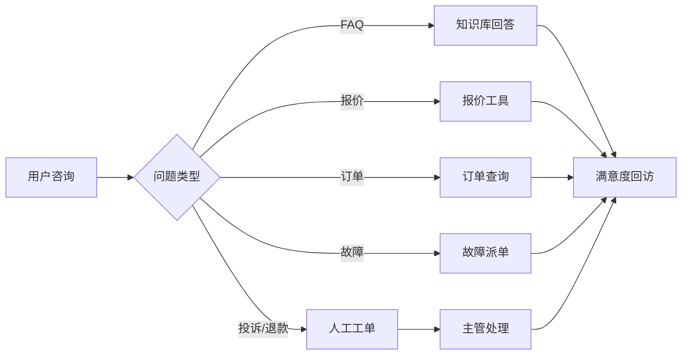
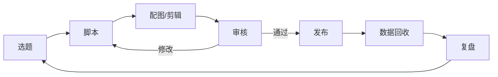

# 流程图与自动化机会矩阵

> 合成流程数据，用于演示“流程梳理 → 机会识别 → 优先级排序”。不是某公司真实流程。

## 1. 运营流程：从需求到退租


关键痛点：

- 需求分散在微信、Excel、电话。
- 选型依赖工程师经验。
- 报价多版本、易出错。
- 合同用印线下流转。
- 退租结算跨财务、交付、客服。

## 2. 客服流程：咨询到投诉



关键痛点：

- 重复问题多，新人培训周期长。
- 工单靠人工分派。
- 投诉高情绪、高风险。
- 回访记录不完整。

## 3. 新媒体流程：选题到数据回收



关键痛点：

- 选题依赖个人灵感。
- 脚本结构重复。
- 设计外包沟通成本高。
- 多平台手工发布。
- 复盘没有和线索打通。

## 4. 数据流程：日报到客户标签


关键痛点：

- SQL 重复编写。
- 指标口径不一致。
- 标签规则散落。
- 报表多，决策少。

## 5. 机会矩阵

评分公式：

```text
月工时 = 平均耗时 × 月发生量 / 60
优先级分 = 月工时 × 自动化潜力 × 数据就绪度 / 风险
预计节省工时 = 月工时 × 自动化潜力 × 60%
```

当前 Top 6（合成数据）：

| 排名 | 节点 | 流程 | 月工时 | 自动化潜力 | 风险 | 优先级分 | 建议 |
| ---: | --- | --- | ---: | ---: | ---: | ---: | --- |
| 1 | 日报取数 | 数据流程 | 165.0 | 90% | 1 | 141.1 | 先做，规则清晰、数据就绪 |
| 2 | 日常咨询响应 | 客服流程 | 120.0 | 90% | 1 | 97.2 | 先做，RAG + 转人工 |
| 3 | 报价审批 | 运营流程 | 150.0 | 80% | 2 | 48.0 | 做工具 + 审批流，不直接承诺 |
| 4 | 客户需求登记 | 运营流程 | 84.0 | 85% | 2 | 32.1 | 表单 + 抽取 + CRM 同步 |
| 5 | 发货跟踪 | 运营流程 | 100.0 | 75% | 2 | 31.9 | 物流 API + 主动通知 |
| 6 | 配图/剪辑 | 新媒体流程 | 90.0 | 60% | 1 | 27.0 | 先做模板和提示词，人工挑选 |

## 6. 优先级解释

- **先做**：日报取数、日常咨询。数据就绪、风险低、重复度高。
- **第二步**：报价审批、需求登记、发货跟踪。需要系统打通，但可控。
- **谨慎做**：投诉、合同用印、退租结算。高风险，先做“AI 辅助 + 人工复核”。
- **不建议先做**：需要大量现场判断的选型、复杂故障诊断。

## 7. 从流程到产品

| 流程节点 | 产品形态 | 输入 | 输出 | 人工接管 |
| --- | --- | --- | --- | --- |
| 日报取数 | 数据问答 / 报表 | 自然语言问题 | 指标 + 图表 | 口径争议 |
| 日常咨询 | 客服 Agent | 用户问题 | 答案 + 引用 | 低分/投诉 |
| 报价审批 | 报价工具 | 设备/数量/天数 | 报价单 | 折扣/特殊条款 |
| 需求登记 | 表单 + 抽取 | 对话/邮件 | 结构化需求 | 信息不全 |
| 发货跟踪 | 订单助手 | 订单号 | 节点/ETA | 异常订单 |
| 配图/剪辑 | 内容 Workflow | Brief | 提示词/草稿 | 品牌审核 |

## 8. 数据文件

- 原始节点：[`data/environment/process_steps.csv`](../data/environment/process_steps.csv)
- 自动生成的报告：[`reports/process_opportunities.md`](../reports/process_opportunities.md)
- 计算代码：[`ai_portfolio/environment/process.py`](../ai_portfolio/environment/process.py)
